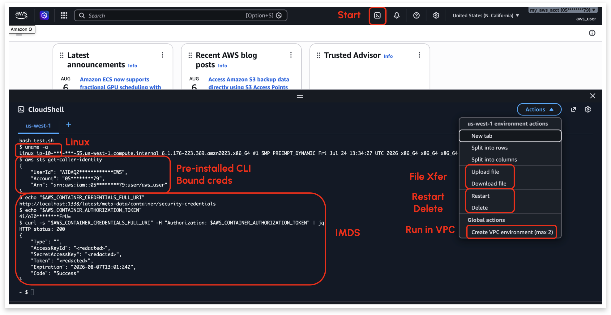

# CloudBasher 

---

<a id="id-contents"></a>
## Contents

[1. Releases](#id-releases)  
[2. Overview](#id-overview)  
&nbsp;&nbsp;&nbsp;&nbsp;[2.1 Origin Story](#id-origin-story)  
&nbsp;&nbsp;&nbsp;&nbsp;[2.2 CloudShell](#id-cloudshell)  
&nbsp;&nbsp;&nbsp;&nbsp;[2.3 CloudBasher API and POC Toolkit](#id-cloudbasher-api)  
&nbsp;&nbsp;&nbsp;&nbsp;[2.4 Documentation and Files](#id-documentation)  
[3. Install](#id-install)  
&nbsp;&nbsp;&nbsp;&nbsp;[3.1 Cloud Service Provider accounts](#id-csp-accounts)  
&nbsp;&nbsp;&nbsp;&nbsp;[3.2 python 3.11 (or newer)](#id-python)  
&nbsp;&nbsp;&nbsp;&nbsp;[3.3 uv (recommended)](#id-uv)  
&nbsp;&nbsp;&nbsp;&nbsp;[3.4 pip](#id-pip)  
&nbsp;&nbsp;&nbsp;&nbsp;[3.5 playwright](#id-playwright)  
[4. Quick Start](#id-quick-start)  
&nbsp;&nbsp;&nbsp;&nbsp;[4.1 Configure CSP Environment](#id-configure-csp-environment)  
&nbsp;&nbsp;&nbsp;&nbsp;[4.2 Configure Credentials File](#id-configure-credentials-file)  
&nbsp;&nbsp;&nbsp;&nbsp;[4.3 Start CloudBasher](#id-start-cloudbasher)  
&nbsp;&nbsp;&nbsp;&nbsp;[4.4 Provision Node](#id-provision-node)  
&nbsp;&nbsp;&nbsp;&nbsp;[4.5 Connect a Terminal Session](#id-connect-terminal-session)  
&nbsp;&nbsp;&nbsp;&nbsp;[4.6 Execute Bulk Commands](#id-execute-bulk-commands)  
[5. Interactive Commands](#id-interactive-commands)  
[6. Credentials](#id-credentials)  
[7. Research](#id-research)  
[8. License](#id-license)  
[9. Security](#id-security)  
&nbsp;&nbsp;&nbsp;&nbsp;[9.1 On screen](#id-security-on-screen)  
&nbsp;&nbsp;&nbsp;&nbsp;[9.2 On disk](#id-security-on-disk)  
[10. Contributing](#id-contributing)  
[11. Contact](#id-contact)  

---
<a id="id-releases"></a>
## 1. Releases

**Scheduled**

| Version | Date | Event | Description |
|---|---|---|---|
| **v0.9.1** | **October&nbsp;16,&nbsp;2026** | — | <ul><li>Documentation rendering fixes</li><li>Dependency updates</li></ul> |
| **v0.90** | **October&nbsp;16,&nbsp;2026** | SECTOR&nbsp;2026<br>DEFCON&nbsp;34 | <ul><li>Core AWS/Azure/GCP CloudShell functionality</li><li>Core API library (1:1 native CloudShell, CRUD container, file transfer, terminal, heartbeat, error-handling)</li><li>Services (session handling, container reset/invalid credential recovery, bulk commands, multiple credential types)</li><li>POC Tooling (TUI/CLI for multi-container management)</li></ul> |


<a id="id-overview"></a>
## 2. Overview

<a id="id-origin-story"></a>
### 2.1 Origin Story

**CloudBasher** (**`<l0ud💥bash3r`**) started with a Cloud Village CTF challenge built for DEFCON 33 (2025) which hid a flag in an AWS CloudShell environment. The premise was to challenge participants to discover, gain access, and exfil a flag from a cloud service that is largely unmanaged with no publics APIs, browser-only interactive access by default, and with a Linux container environment that was locked down without root and missing package/install/file transfer capabilities. This "fun" project led to numerous speculations by the builders:
- What if there was an API, how would that change the red/blue views on the service?
- If we automate management of the containers, what use cases could we build?
- If it's "free-ish", does that make mining in container slices profitable?
- Can the ephemeral nature of environments be overcome e.g. container resets?
- Can the persistent $HOME dir be used for data exfil, backdoors, etc?
- What are the authentication / token flows involved?

CloudBasher is the representation of the follow-on research done in automating the CloudShell API and building of a basic POC to manage and manipulate CloudShells containers across AWS, GCP, and Azure.


<a id="id-cloudshell"></a>
### 2.2 CloudShell

**CloudShell** is free-ish container environment with pre-installed cloud CLIs, auto-binding of IAM credentials, for admins to use in safely administering their cloud environments from within the authenticated IAM walls of their cloud environments. Depending upon cloud service provider, CloudShells may have basic IAM permissioning, some logging of CRUD operations by the user, and typically have persistent `$HOME` directory options, but have container auto-resets, and some quotas on CPU or active containers.

<table>
  <tr>
    <td>
      
      <br>
      <div align="center"><strong>Figure 1: CloudShell Browser Terminal</strong></div>
</td>
  </tr>
</table>

<table>
  <tr>
    <td>

```
                                         .-~~~~~-.
           ┌───────────────────────────>(   AWS   )
           │           Private           `-~~~~~-'
           │           REST API              ┆
           │           Calls                 ┆
           │                                 ┆
           │             Credential Binding  ┆  Idle Shutdown (10-20min)
           │                      e.g. IMDS  ┆  Hard reset (12h)
           │                                 v
    ┌──────┴──────┐                   ┌─────────────┐
    │ WEB BROWSER │   Websocket       │  CONTAINER  │                              .-~~~~~-.
    │             │<═════════════════>│             │<───────────────────────────>(   AWS   )
    └─────────────┘   Terminal        └─────────────┘        API Calls             `-~~~~~-'
                      session       sudo ?     Persistent
                                                 $HOME

                                           FREE                             Charged by API/Service

                                          Quotas
                              AWS: 10 running containers/region
                                     AWS: 200 hrs/month
                                      GCP: 50 hrs/week
```

<div align="center"><strong>Figure 2: CloudShell High-Level Architecture</strong></div>

</td>
  </tr>
</table>

<a id="id-cloudbasher-api"></a>
### 2.3 CloudBasher API and POC Toolkit

CloudBasher implements the CloudShell protocols for AWS, Azure, and GCP, and includes services and a POC toolkit for multi-cloud CloudShell management in the form of a CLI/TUI for **AWS CloudShell**, **GCP Cloud Shell** and **Azure Cloud Shell** and includes functionality such as:

  - a split-pane terminal UI as well as a batch CLI mode for one-time command execution
  - CRUD of CloudShell containers
  - terminal connect to a container
  - batch command execution
  - file transfer
  - heartbeat management
  - command macros and some basic command looping
  - single command, bulk provisioning for AWS containers across regions and assume role and federeration identities
  - support of multiple credential types
    - AWS: Console, SSO Console, AKIA access keys (assume role, federation, and direct0, and ASIA temp tokens
    - Azure: Console, OAuth refresh tokens, OAuth access tokens
    - GCP: Console, OAuth refresh tokens, OAuth access tokens
  - error-handling and recovery of sessions
  - encryption of state files and retrieval secrets stored in 1Password

<a id="id-documentation"></a>
### 2.4 Documentation and Files

| Document | Read it for |
|---|---|
| [`docs/setup-csp.md`](docs/setup-csp.md) | What to set up **in the cloud account** first, per provider, and which permissions are actually needed |
| [`creds.rc.example`](creds.rc.example) | The `-F` file: a fill-in template for the supported AWS, Azure, and GCP credential types |
| [`docs/credential-file.md`](docs/credential-file.md) | The `-F` file in full: every block, every key and its aliases, what `ACT_AS` means per provider, and which credential type reaches which environment |
| [`docs/configuration.md`](docs/configuration.md) | `cloudbasher.rc` — UI, redaction, fan-out tuning |
| [`docs/lifecycle.md`](docs/lifecycle.md) | The node lifecycle, as a state diagram: what each command transitions |
| [`docs/tui-reference.md`](docs/tui-reference.md) | Screen layout, status glyphs, every key, every dot-command |
| [`docs/scenarios.md`](docs/scenarios.md) | End-to-end walkthroughs per credential type and per provider |
| [`docs/examples.md`](docs/examples.md) | Non-interactive and scripted use |


<a id="id-install"></a>
## 3. Install

CloudBasher speaks to each provider's CloudShell control plane directly over HTTPS and WebSocket, which is a private API. There are no dependencies on the CSP CLIs (`aws`, `gcloud` or `az`), and it does not read their config files for credentials.

<a id="id-csp-accounts"></a>
### 3.1 Cloud Service Provider accounts

There are additional details about credential types and permissions described in the Quick Start, Credentials, and the AWS CloudShell sections.

<a id="id-python"></a>
### 3.2 python 3.11 (or newer)

<a id="id-uv"></a>
### 3.3 uv (recommended)

```bash
# One-time, if you do not have uv:
#   https://docs.astral.sh/uv/getting-started/installation/
# The project uses `./venv/` rather than uv's default `./.venv/`; `run.sh` accepts either.
export UV_PROJECT_ENVIRONMENT=venv
uv sync --extra aws --extra gcp --extra azure
```

Drop the extras you don't need — `--extra aws` alone is a smaller install.

<a id="id-pip"></a>
### 3.4 pip

NOTE: `requirements.txt` is generated from `uv.lock`, so the two resolve identically.

```bash
python3 -m venv venv
venv/bin/pip install -r requirements.txt
venv/bin/pip install --no-deps .
```

`--no-deps` is deliberate: `requirements.txt` already pins every transitive dependency.

<a id="id-playwright"></a>
### 3.5 playwright

AWS console and AWS SSO credentials are completed in a real browser. Neither pip nor uv can fetch that browser, so it is a separate one-time step:

```bash
venv/bin/playwright install chromium
```

Only console/SSO credential types need it. Plain access keys, GCP service accounts and Azure service principals do not.

<a id="id-quick-start"></a>
## 4. Quick Start

<a id="id-configure-csp-environment"></a>
### 4.1 Configure CSP Environment

- AWS
    - Create IAM user U1, with CloudShell permissions
    - Create Permanent Access Keys
    - Create Role R1, with CloudShell permissions
    - Trust IAM user U1, from Role R1
    - Allow IAM user U1 to sts:assumeRole Role R1

<a id="id-configure-credentials-file"></a>
### 4.2 Configure Credentials File

Copy credential info in ENV variable or json format (see `creds.rc.example`) into creds.rc:

```bash
cp creds.rc.example creds.rc      # then edit it — the template documents every shape
chmod 600 creds.rc
```

<a id="id-start-cloudbasher"></a>
### 4.3 Start CloudBasher

```
./run.sh -F creds.rc 
```

That opens the multi-node TUI with your identities loaded and **no** CloudShell environment yet. Nothing is provisioned until you ask.

<a id="id-provision-node"></a>
### 4.4 Provision Node

In the Credential Pane, move the cursor to a row and use 'p' to provision one or more nodes with that credential. Press `:` to open the command bar, then:

```text
.provision selected region us-west-1           start + connect to a CloudShell environment in us-west-1 using that credential
```

<a id="id-connect-terminal-session"></a>
### 4.5 Connect a Terminal Session

1. Use '`t`' to connect to the Terminal shell.
2. aws sts get-caller-identity

Ctrl-D or `exit` will close the Terminal and return to the Credentials View.

<a id="id-execute-bulk-commands"></a>
### 4.6 Execute Bulk Commands

In the main Credentials Pane, select the running node in us-west-1. Then type 'b' to run a bulk command.
```
bulk selected uname -a      # run a command on every connected node, see truncated output and exit status in Credential Pane
output ALL                  # show the full output for each in the Log Pane
```

<a id="id-interactive-commands"></a>
## 5. Interactive Commands

Everything CloudBasher does after startup is driven by dot-commands typed into the session. `.help` lists them, `.help <command>` gives one in full, and `?` shows the whole document below -- all from one builder, so this page cannot describe a help text the program does not print.

In the TUI the `?` overlay pages with SPACE / shift-SPACE, Ctrl-d / Ctrl-u for half a screen, and Ctrl-f / Ctrl-b for a full one. The Status glyphs are colour-coded on screen; colour is flattened here.

```text
<l0ud💥bash3r - Interactive Commands

  .help               This help
  .help <command>     Full help for one command -- arguments, notes, examples
  .help keys          Nodes-pane keybindings
  .help status        The Status column's glyphs

Node lifecycle:
  .connect            Create a WebSocket session to selected node(s)
  .disconnect         Close the WebSocket session for selected node(s), leaving the environment(s) running
  .provision          Create, start, and connect to CloudShell environment(s) for one or more credential(s)
  .start              Start or resume the selected node(s) environment(s)
  .stop               Suspend the selected node(s) environment(s)
  .delete             Delete each matched node's CloudShell environment
  .unregister         Remove the nodes from view/the registry, but leaving CloudShell environment alone
                      (a session starts with ZERO registered nodes -- .provision, or
                      .enum <region> register to adopt existing ones)

Commands:
  .bulk               Run a command on the nodes a selector matches
  .output             Show the full last bulk output for those nodes

Shell / terminal:
  .command            Run one shell command on the active node, or enter shell mode
  .ls                 List a remote directory on the active node
  .upload             Copy a local file into the active node
  .download           Copy a file out of the active node

Session info:
  .enum               Find CloudShell environments for one or more credentials across regions
  .creds              Show loaded identities, probe what they may do, or re-derive one
  .state              Show session state
  .history            Show command history

Housekeeping:
  .heartbeat          Send one heartbeat, or start a keepalive loop every N seconds
  .echo               Print a message
  .sleep              Pause for N seconds
  .verbose            Echo the log to the console: on, off, or show
  .ui                 Show the current UI mode (`tui` is the only one in this release)
  .run                Execute a dot-command batch file line by line

Job control:
  .loop               Run a shell command in a background loop
  .jobs               List background jobs
  .fg                 Bring a background job to the foreground
  .bg                 Resume a suspended job in the background
  .kill               Stop a background job

Watching a fan-out:
  The node pane scrolls to keep the active group -- the lowest still-Pending
  node -- in view while a .provision runs, and the State row counts progress
  ("Provisioning 44/160"). The CURSOR never moves: it is what an unticked
  command acts on. A manual scroll pauses the following for 30s.

Recovery:
  .enum ... reconcile Diff what AWS reports against what this tool recorded
                      creating. Adopts nothing, deletes nothing -- it answers
                      "does the cloud match what I think I have"

Interrupt:
  Ctrl-C              Stop the running command. Nothing further is started; work
                      already in flight is left to finish (never killed), so
                      anything created is still recorded. Press again for what is
                      still running

Exit:
  .exit / .quit / Q   Quit from the CLI pane (also Ctrl-D) or CloudBasher


──────────────────────────────────────────────────────────────────────────────

Status — three independent glyph slots: [container] [connection] [control plane]


  Container    ●   Running        up and usable
               ▲   Suspended      .start resumes it
               ✗   Failed         ERROR/DELETED, or bootstrap failed
               ⊘   CredentialInvalid  heartbeat found the credential dead
               ?   Unknown        the CSP reported a status we don't map
               –   (none)         no status on record

  Connection   ✓   Connected      a live session is held
               ↻   Retrying       heartbeat is mid-retry-cycle
               ⧗   Recovering     shell stopped executing; sockets being rebuilt
               –   Disconnected   no session in this process

  Control plane ✓   Accepted       latest request authenticated
               ↻   Retrying       request/heartbeat retry in progress
               ✗   Rejected       authentication explicitly rejected
               !   Denied         authenticated principal lacks permission
               ?   Inconclusive   no authentication verdict
               –   Unasked        no control-plane result observed

Activity is a separate column: ⧗ means work is running on the node; · means
the work is queued. Transition tint on the existing status glyph indicates
direction without replacing the underlying state.

──────────────────────────────────────────────────────────────────────────────

Keys — Nodes pane

  (Nodes pane) b            Arm bulk selected <cmd> for the current selection.
  (Nodes pane) o            Arm output selected to show last output for the current selection.
  (Nodes pane) p            Arm provision to create new CloudShell environments.
  (Nodes pane) c            Arm connect selected to open sessions for the current selection.
  (Nodes pane) d            Arm disconnect selected to close sessions for the current selection.
  (Nodes pane) s            Arm start selected to resume suspended/stopped environments.
  (Nodes pane) S            Arm stop selected to suspend running environments.
  (Nodes pane) U            Arm unregister selected to drop the current selection from the local registry.
  (Nodes pane) D            Arm delete selected to permanently delete the underlying cloud environment.
  (Nodes pane) t            Open/close the side terminal for the highlighted node.
  (Nodes pane) x            Toggle selection of the highlighted row or group (also sets the range-select anchor).
  (Nodes pane) X            Select every row between the last 'x'-toggled row and here, inclusive (Gmail-style).
  (Nodes pane) a            Select (or deselect) every node.
  (Nodes pane) j            Move the highlight down one row (vi-style alias for ↓).
  (Nodes pane) k            Move the highlight up one row (vi-style alias for ↑).
  (Nodes pane) enter        Expand/collapse the highlighted group.
  (Nodes pane) e            Expand/collapse the highlighted group (same as Enter).
  (Nodes pane) E            Expand every credential's nodes, or collapse them all.
  (Nodes pane) 1            Show the Credential View (credentials, with their nodes nested). A DIRECT selector, not a toggle -- pressing it twice leaves you here.
  (Nodes pane) 2            Show the Node View (every node, flat). A DIRECT selector, not a toggle -- pressing it twice leaves you here.
  (Nodes pane) v            Show full ARNs in Identity, Acts As and Target IdentityARN instead of the short forms. The pane scrolls horizontally while this is on.
  (Nodes pane) left / right Page the Nodes table's columns left.
  (Nodes pane) h            Page the Nodes table's columns left (vi-style alias for ←).
  (Nodes pane) l            Page the Nodes table's columns right (vi-style alias for →).
  (Nodes pane) m            Cycle demo redaction of sensitive fields on/off.
  (Nodes pane) z            Zoom the Info pane to full height (Nodes keeps its header + cursor row); press again to restore.
  (Nodes pane) Q            Arm 'quit' in the command bar; Enter confirms, Escape cancels.
  (Nodes pane) :            Focus the one-line command bar (Esc returns to Nodes/Info).
  (Nodes pane) ?            Open the help overlay (the same text as .help); Esc, q or ? closes it.
```

<a id="id-credentials"></a>
## 6. Credentials

To provide clarity on which target environment credentials are loaded within CloudBasher, credentials are normally stored in a local file (see creds.rc.example for a template) and passed in via the `-F` command-line switch. Alternatively, one-time credentials can be set as environment variables and will be read with the `--creds-env` switch:

| Flag | Source |
|---|---|
| `-F`, `--creds-file PATH` | a credential file (the usual choice) |
| `--creds-env` | this provider's conventional environment variables |
| `-m`, `--resume [FILE]` | an encrypted saved session |

They are mutually exclusive and one is **required**. There is no ambient discovery: CloudBasher never reads `~/.aws/credentials`, an instance role, container credentials, GCP application-default credentials, or the `gcloud` / `az` CLIs.

On AWS there is a second mandatory declaration: every key-based block must say what it acts as (`ACT_AS=federated`, `ACT_AS=role:<arn>`, or `ACT_AS=direct`).  The rules for each, and why the identity name it derives is a **namespace** rather than a label, are in `creds.rc.example` alongside the shape they apply to.

<a id="id-research"></a>
## 7. Research

Some of the research that fell out of the reverse-engineering of the CloudShell protocols, the journey of operationalizing the CloudShell APIs, and development of CloudBasher POC toolkit include:

<a id="id-research-notes"></a>
### 7.1. Analysis

- [AWS CloudShell Protocol](docs/aws-cloudshell.md)
- [Azure CloudShell Protocol](docs/azure-cloudshell.md)
- [GCP CloudShell Protocol](docs/gcp-cloudshell.md)

<a id="id-research-talks"></a>
### 7.2. Talks 

- **CloudBashing: Exploiting free CloudShells for mining, networking, exfil, and persistence at scale** (DEFCON 34, Aug 2026)
    - [Slides](https://github.com/edleft/content/blob/main/DC34_MainStage_CloudBashing.pdf)

<a id="id-license"></a>
## 8. License

Copyright &copy; 2026 edleft. All rights reserved.

CloudBasher is an independent personal project by edleft. It is not a product of, affiliated with, endorsed by, or supported by any employer, client or organization of the author. All code, research and views published here are the author's own.

CloudBasher is **source-available, not open source**, under the CloudBasher Research Source License. In brief:

- Cybersecurity research, authorized testing, education, internal enterprise security work and commercial security consulting are **permitted**.
- Commercial resale, repackaging, productization or hosted delivery of CloudBasher itself is **restricted**.
- Private/internal AI training, fine-tuning and RAG are **permitted**.
- Training or materially improving AI systems made available outside your organization is **restricted** without separate written authorization.

See [`LICENSE`](LICENSE) for the operative terms, [`AI_USAGE.md`](AI_USAGE.md) for the AI and machine-learning policy, and [`LICENSE-FAQ.md`](LICENSE-FAQ.md) for worked examples. The FAQ is explanatory only; where it and the LICENSE differ, the LICENSE governs.  Third-party components retain their own upstream terms — see [`NOTICE`](NOTICE).

Where a use is **restricted**, it is restricted *without separate written authorization* rather than prohibited. Requests go to <cloudbasher@edleft.org> — see [Contact](#id-contact).

<a id="id-security"></a>
## 9. Security

CloudBasher handles live cloud credentials. The split worth understanding is **what it shows you** versus **what it stores on disk** — they are governed by different rules.

<a id="id-security-on-screen"></a>
### 9.1 On screen

- **Secrets are never displayed.** Secret access keys, session tokens and bearer tokens are reduced to `first4********last4` before they reach any buffer, in the TUI panes and the Log pane alike. This has no toggle.
- **Identifying values are shown in full by default.** Usernames, email addresses, account numbers, hostnames, IPs and API key *IDs* are displayed as they are. A key ID is an identifier, not a secret — AWS's own console shows it, and it is useless without the matching secret. Showing it is what lets you tell one credential apart from another at a glance.
- **A masking mode hides those identifiers when you need it to.** Press `m` in the TUI, or start with `--redact`, before a demo, a screenshot or any shared screen. It applies to what is *already* on screen, not just to new output, so you can turn it on after the fact.

<a id="id-security-on-disk"></a>
### 9.2 On disk

Credential files, the log file and the state file **can and do hold complete credentials, secrets included**. Nothing above applies to them — the log in particular is written raw and unmasked, deliberately, because it is a local audit trail while your terminal may be screen-shared.

**Securing these files is yours to do.** Only the state file is given `0600` explicitly; the log is written with your default umask, and a credential file has whatever permissions you gave it. Place the log deliberately with `-l/--log`, and treat all three as you would any file holding live cloud credentials.

CloudBasher offers two optional measures to reduce what sits in plaintext:

- **Encrypted session state.** Supply a passphrase and the state file is written with AES-256-GCM under an scrypt-derived key. Skip the passphrase and no state is written at all — it is never persisted in plaintext.
- **1Password-backed secrets.** A `-F` credential file can carry `op://vault/item/field` references in place of literal secrets, resolved through the 1Password CLI at load time, so the secret never lands in the file.

Neither is a default. Both are worth turning on.

Report vulnerabilities as described in [`SECURITY.md`](SECURITY.md). Do not open a public issue for a security report.

<a id="id-contributing"></a>
## 10. Contributing

See [`CONTRIBUTING.md`](CONTRIBUTING.md). This repository is a published distribution of a private development repository; changes flow one way, from private to public.

<a id="id-contact"></a>
## 11. Contact

Pick the channel by what the message is, not by which is quickest:

| What | Where |
|---|---|
| Bugs, defects, technical problems | this repository's **Issues** |
| Questions, general inquiries | this repository's **Discussions** |
| **Security vulnerabilities** | **Security** → **Advisories** → **Report a vulnerability** |
| Licensing, authorization requests, private matters | <cloudbasher@edleft.org> |

A security report filed as an Issue is world-readable the moment it is submitted and cannot be un-read; that is why it has its own channel. See [`SECURITY.md`](SECURITY.md).
